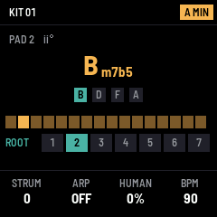
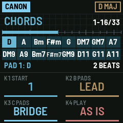
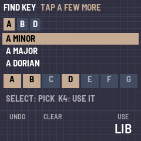
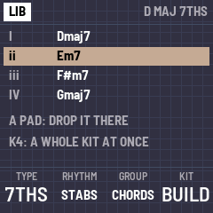
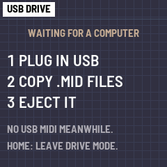
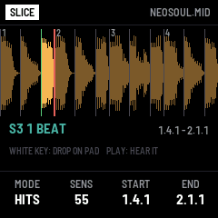
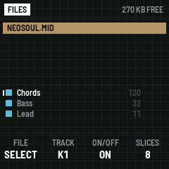

# ChordSmith FM

ChordSmith FM is a chord and phrase player for the M-VAVE FM-1 by BeatSmith. Its 16 pads hold chords and phrases:
the chords of any key, slices of MIDI files you copy onto it, or progressions from its library.

## Contents

1. Install
2. Playing: the pads and the degree keys
3. The controls
4. KEY: the key, the scale lock, transposing by degrees
5. FX: strum, arp, humanize, inversion, a bass note
6. LIB: the chord library
7. MIDI files: the USB drive and REC
8. SLICE and FILES
9. TRIM: a pad's start, end, tune, level and play mode
10. Kits and saving
11. MIDI and sound
12. Troubleshooting

---

## 1. Install

To try it first, open the emulator in a browser. It runs the same code, with sound.

To install it, use Chrome or Edge on a computer. Connect the FM-1 by USB, open the installer and press Install. Allow
MIDI when the browser asks. Don't unplug the cable while it writes. From a terminal:
`python3 tools/fm1_install.py chordsmith-VERSION.fwsc`.

To go back to the stock firmware, use the installer's last section with M-VAVE's own firmware file. On its first
start ChordSmith FM sets up its drive in the FM-1's spare flash.

## Getting started: GUIDE

The first time ChordSmith starts, it opens **GUIDE**: twelve short pages, from playing chords to slicing a MIDI file.
Turn **SELECT** for the next page. The keys and buttons a page talks about **blink**: press a blinking button to
try it (that leaves the guide), and **hold SYS** to come back to the guide at any time. HOME on its own leaves it.

## ORCHID: play a MIDI file at once

ChordSmith starts in **ORCHID**. Load a MIDI file and it's already on the 16 pads: no slicing to do.

| Control | Turn it to choose |
|---|---|
| PRESET | How the file is cut: EQUAL (16 equal parts), BARS, 2 BARS, HITS (each new hit), CHORDS (each chord change, its name on the pad) |
| K1 | Where in the song the 16 pads start: one slice a click |
| K2 | The black keys 1-7: ROOT or LEAD (3RD and 5TH to come) |
| K3 | The 4 extra black keys (to come: BRIDGE, SUGGESTED, OUTSIDE, RELATIVE) |
| K4 | How the pads play (to come: CHORD, STRUM, ARP, SLOPPY, PERFORM) |

The bar under the mode shows the whole song and the stretch of it on the pads.

**Hold HOME** for **FM mode**: every other screen (SLICE, TRIM, LIB, KEY, FX, kits). HOME there shows a teal **FM**.
The pads stay as ORCHID left them, to fine-tune. **Tap HOME** to come back to ORCHID, just as you left it: its
own slices on the pads again. Pressing one of FM mode's screen buttons in ORCHID takes you to FM mode too.

## 2. Playing

The **16 white keys are pads**, left to right. A new kit holds the key's chords: pads 1 to 7 the seventh chords on
each degree, pad 8 the first an octave up, pads 9 to 15 the ninth chords, pad 16 a sus4 on V.

The **first seven black keys are the scale's degrees**. SEQ (MODE) switches what they do:

- **ROOT**: each plays a bass note an octave under the pads. When a pad plays, the black key of its chord's root
  lights up, so you can add the bass under it.
- **LEAD**: each plays a lead note an octave over the pads. While a phrase plays, the black keys follow its top
  note: the key of the note sounding now is full, the key of the next one breathes. Play along on them. A chord pad
  held lights its top note.

HOME shows the mode beside the degree row.

### F1-F4: key changes for a bridge

The **last four black keys** change key, always from your home key:

| Key | Goes to | From C major | From A minor |
|---|---|---|---|
| F1 | The relative key: the same notes | A minor | C major |
| F2 | The parallel key: the same tonic | C minor | A major |
| F3 | Up a 4th, the usual bridge | F major | D minor |
| F4 | Up a step, the last-chorus lift | D major | B minor |

**Tap** one to go there: the key's chords on the pads follow, the F key stays lit and HOME shows it beside the key.
Tap the lit one to come home. Tapping another goes there from home, so you're only ever one change away.

**Hold** one for a look first: the screen names the key and the pads whose chords fit it light up, the pivot
chords that lead you into it smoothly. Let go after a moment and nothing changes. Picking a key by hand (ROOT, KEY,
FIND) makes it the new home.

The lights: an empty pad is dark, a loaded pad glows, a playing pad is lit. In SLICE and LIB the pads breathe to show
they take a drop.

HOME shows the chord, its numeral in the key, its notes with the root marked, the 16 pads (amber chords, teal
phrases) and the degree keys.

## 3. The controls

| Control | Does |
| --- | --- |
| White keys | Play a pad. In SLICE or LIB, drop the selected slice or chord on that pad |
| Black keys 1-7 | Play the scale's degrees: bass notes (ROOT) or lead notes (LEAD) |
| Black keys F1-F4 | Key changes from home: tap to go, tap again to come back, hold to look |
| ALGORITHM (ROOT) | The key's root. With OCT- or OCT+ held, the scale |
| PRESETS (KIT) | The kit, 1 to 8 |
| SELECT | Pick a slice, a file or a library row |
| K1 to K4 | What the screen's bottom bar says |
| OCT- / OCT+ | The octave. Both together: the scale lock on or off |
| HOME | ORCHID. Leaves any screen |
| HOME (hold) | FM mode's HOME |
| SYS (hold) | GUIDE: the getting-started pages |
| SEL (SLICE) | SLICE; again, FILES |
| ENV (TRIM) | Trim the pad played last |
| LFO (LIB) | The chord library |
| EDIT (KEY) | The key screen |
| FX | Chord FX; again, the second page |
| GLO (SYS) | The USB drive |
| SAVE | Save the settings and the kit |
| PLAY | In SLICE and LIB, hear the selection; in KEY, detect the file's key; elsewhere, all notes off |
| REC | Record MIDI coming in, again to stop and save it |
| REC + PLAY | FIND: tap a few notes, pick a key that has them |
| SEQ (MODE) | The black keys: ROOT or LEAD |

On FM mode's HOME, K1 is the strum, K2 the arp, K3 humanize and K4 the tempo, and PRESET the kit.

## 4. KEY

K1 the root, K2 the scale (minor, major, the modes, harmonic and melodic minor), K3 the step shift, K4 the lock.

With the **scale lock** on, every note that plays, from chord pads, phrases and the degree keys, snaps to the key.
The **step shift** then moves every note by scale degrees: Am7 two steps up becomes Cmaj7, still in the key.

PLAY on this screen finds the key of the loaded file.

### FIND: a key from a few notes

Press **REC and PLAY together**. Every key, white and black, is now a note from F3 up: tap a few notes of a melody or
a chord you have in your head. FIND lists every key that has all of them, best first: the first note you tapped as
the tonic, then major and minor before the modes. SELECT picks one; the keyboard lights its notes, the ones you
tapped full. K1 takes back the last note, K2 clears them all. **K4 uses the key** and opens LIB, its chords ready
to drop on the pads. HOME leaves the key as it was.

## 5. FX

FX shapes the chord pads (phrases play as they were played).

- **Strum**: the notes one after another, 2 ms to 200 ms apart.
- **Arp**: up, down, up and down, or random, while the key is held. Its rate is on page 2: 1/4 to 1/32, triplets too.
- **Humanize**: each note a little late and its velocity a little off.
- **Invert**: the lowest note up an octave (or the highest down), up to three times.
- **Bass note** (page 2): the root an octave under the chord.

## 6. LIB

The library is built from the key. K3 picks the group: the seven **chords** of a type (K1: triads, 7ths, 9ths, sus2,
sus4, add9), or ten four-bar **progressions** in a rhythm (K2: sustain, stabs, arp 8ths) with a bass line. SELECT
picks a row and plays it; a white key drops it on that pad. K4 builds a whole kit: the chords on pads 1 to 8, the
progressions on 9 to 16.

## 7. MIDI files

**The USB drive**: press SYS. The FM-1 shows the computer a drive called CHORDSMITH (about 270 KB). Copy `.mid` files
onto it, then eject it. There's no USB MIDI while the drive is on; HOME leaves drive mode. Press SYS briefly: held, it opens the guide.

**REC**: press REC and play MIDI into the FM-1 (USB or the TRS jack). Press REC again: the recording is saved on the
drive as RECnn.MID and opens in SLICE.

## 8. SLICE and FILES

SLICE shows the file as a waveform, four bars at a time, with its cuts. K1 the mode: **hits** (cuts where notes land
together; K2 the sensitivity) or **grid** (K2 the length, 1/16 to 4 bars). SELECT picks a slice and plays it, K3 and
K4 move its start and end by 16ths. A white key drops it on that pad: a **chord pad** when its notes land together
(named, with its numeral in the key), else a **phrase pad** that plays at the tempo.

SLICE again opens FILES: SELECT picks the file, K1 a track and K2 turns it on or off. Drum tracks start off.

## 9. TRIM

ENV (TRIM) opens the pad played last; a white key there picks another. Nothing is cut away: TRIM only sets what
plays, so you can always widen it again.

- **K1 START, K2 END**: the part of a phrase that plays, by 16ths. The piano roll shades it, START green, END red,
  the playhead white.
- **K3 TUNE**: up or down by semitones (12 at most), for chords and phrases.
- **K4 LEVEL**: how loud, 0 to 100.
- **SELECT** the play mode of a phrase: **ONE-SHOT** plays it to the end, **GATE** only while you hold the key,
  **LOOP** over and over until you press the key again.

SAVE keeps the trims with the kit.

## 10. Kits and saving

A kit is the 16 pads. The KIT knob (PRESETS) switches between eight; an empty one starts with the key's chords.
**SAVE** keeps the settings and the kit, as a file on the drive (KIT01.CSK to KIT08.CSK). Turning KIT without SAVE
leaves the old kit's changes unsaved.

## 11. MIDI and sound

Every note goes out over USB MIDI on channel 1. MIDI in from USB or the TRS jack plays the built-in synth, a simple
twelve-voice sound for now. MASTER is the volume.

## 12. Troubleshooting

If the installer doesn't find the FM-1, use Chrome or Edge, allow MIDI, and close other programs that use its MIDI
port. If the FM-1 doesn't start after an install, it starts in SAFE MODE after two failed starts; USB still works,
so the installer can reach it to install again or put the stock firmware back.

If a file doesn't show in FILES, it isn't a standard MIDI file, or it's too big (96 KB at most).
