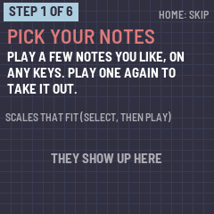
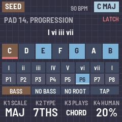
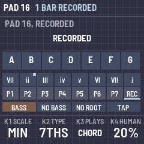

# SEED, MPS-16 ver FM1

SEED is the chord builder of MPS-16, as firmware for the M-VAVE FM-1. Play a few notes you like, pick a scale that
fits them, and the 16 white keys hold that key's chords and progressions. The black keys play the notes of the key
and light up the bass of every chord you play. It sends everything out over USB MIDI, so it can drive the synths you
already have.

This is an early test build by BeatSmith.

## Contents

1. [Install](#1-install)
2. [The first start: COACH](#2-the-first-start-coach)
3. [The keys: A, B and C pads](#3-the-keys-a-b-and-c-pads)
4. [Home](#4-home)
5. [PICK NOTES](#5-pick-notes)
6. [LIB](#6-lib)
7. [PAD EDIT and LOCK](#7-pad-edit-and-lock)
8. [REC, UNDO, SAVE and LOAD](#8-rec-undo-save-and-load)
9. [MIDI and SETUP](#9-midi-and-setup)
10. [All the controls](#10-all-the-controls)

## 1. Install

From Chrome or Edge on a computer, with the FM-1 connected by USB: open the [installer](../install/) and follow it.
The installer can put M-VAVE's own firmware back. You can also [try SEED in the browser](../emu/) first: it runs the
same code, with sound.

## 2. The first start: COACH

The first time SEED starts, it asks whether to show its steps. Turn **SELECT** to choose **NO, NOT NOW**, **THIS FIRST
TIME** or **EVERY START**, then press **PLAY**. You can change it later on the SYS page (K4).

COACH is six short steps. Each one says what to do, and the keys and buttons it means light up or blink. When you do
the step, it moves on by itself:

1. **PICK YOUR NOTES**: play a few notes you like, on any keys.
2. **PICK A SCALE**: turn SELECT to a scale that fits, press PLAY.
3. **PLAY THE PADS**: the white keys blink. Play a few.
4. **PLAY THE BASS**: the bright black key is the bass of the chord you just played.
5. **SHAPE IT**: turn K2 for 7ths and 9ths, K3 for how the pads play.
6. **BASS OR NOT**: try one of the last four black keys.

**HOME** skips the steps. **Hold SYS** to start them again any time.

## 3. The keys: A, B and C pads

- **A pads**: the 16 white keys. Pads 1 to 8 are your key's chords (1 to 7, then the first one an octave up). Pads 9
  to 16 are progressions, four bars each.
- **B pads**: the first 7 black keys. The notes of your key, from the root up.
- **C pads**: the last 4 black keys. **BASS**, **NO BASS**, **NO ROOT** and **TAP**.

The B pads' lights show the chord you played last, so you always know what to play along:

| Light | Means |
|---|---|
| Bright | the bass of the chord |
| Blinking | the bass, taken out by NO BASS or NO ROOT: still the note to play under it |
| Mid | the rest of the chord |
| Dim | the rest of the key |

The screen shows the same thing in the Earth Science colours, as MPS-16 ver WEB does: brown the bass, red the root,
blue the chord, an outline for a note that was taken out.

**BASS, NO BASS, NO ROOT**: BASS plays the chords as they are, and the progressions with a bass line. NO BASS drops
each chord's bottom note and the bass line. NO ROOT drops the root too, as long as two notes stay.

**TAP**: tap it on the beat a few times and the BPM follows. Its light flashes on the beat.

## 4. Home

| Control | Does |
|---|---|
| PRESET | The key's root |
| K1 | The scale (major, minor and the modes) |
| K2 | TYPE: TRIADS, 7THS, 9THS, SUS2, SUS4, ADD9 |
| K3 | PLAYS, for every pad: CHORD, STRUM, ARP, STABS |
| K4 | HUMANIZE, for every pad: a little timing and velocity, like a player |
| SELECT | BPM |
| ALGORITHM | LENGTH, for every pad: left shorter, right longer, all the way right LEGATO |
| OCT- / OCT+ | The keyboard's octave (the B pads and PICK NOTES) |
| HOME, held | SHIFT |

A chord pad plays while you hold it. A progression plays once when you tap it, loops while you hold it past the end,
and stops when you let go after it looped. **SEQ** is **LATCH**: with it on, pads keep playing after you let go, and
tapping a playing pad stops it.

## 5. PICK NOTES

Press **EDIT**. Every key is now a note, like a normal keyboard. Play the notes you like: each one you play is added,
and playing it again takes it out. The scales that hold all of them are listed below, best first (the first note
you played as the root). Turn **SELECT** to choose one and press **PLAY**: the pads are rebuilt in that key. **K1**
clears your notes. EDIT again (or HOME) goes back without changing anything.

## 6. LIB

Press **SEL**. **K1** picks what's listed: TRIADS, 7THS, 9THS, SUS2, SUS4, ADD9 or PROGRESSIONS. Turn **SELECT** to
choose one, **PLAY** to hear it, and a **white key** puts it on that pad. It follows the key when you change it.

## 7. PAD EDIT and LOCK

**ENV** opens PAD EDIT for the pad you played last, as the web's pad edit window:

| Control | Does |
|---|---|
| PRESET | PLAYS: CHORD, STRUM, ARP, STABS |
| K1 | SPEED, 50% to 200% |
| K2 | HUMANIZE |
| K3 | LENGTH |
| K4 | INVERSION, -3 to +3 |
| SELECT | VELOCITY: as you play it, or a fixed one |
| ALGORITHM | The pad's octave (SHIFT: every pad's) |

**LFO** is **LOCK**: it locks the pad you played last, so it stays exactly as it is when the key, type or bass mode
changes. LFO again unlocks it. A small corner marks a locked pad.

## 8. REC, UNDO, SAVE and LOAD

**REC**: the A pads blink. Tap the pad to record into, then a bar of clicks counts you in. Play the B pads, the chord
pads or MIDI in, and press REC again to stop. The take is rounded to whole bars and goes on that pad. REC before the
count ends cancels.

**ARP** is **UNDO**: one step back (a LIB drop, a take, clearing the pads, a LOAD). ARP again goes forward.

**SHIFT + PLAY** (hold HOME, press PLAY) clears every pad that isn't locked. Turn PRESET to bring the kit back, or
ARP to undo.

**SAVE** keeps the pads, their PAD EDIT and the settings. **Hold SAVE** to LOAD them back.

## 9. MIDI and SETUP

MIDI goes out over **USB** and **Bluetooth** (the FM-1's TRS jack is MIDI in only), on four fixed channels:

| Channel | What |
|---|---|
| 1 | Pads 1 to 8 (chords) |
| 2 | Pads 9 to 16 (progressions) |
| 3 | B pads |
| 4 | The keyboard: PICK NOTES and LIB previews |

Set your synths to listen on those. SETUP shows the map too. **PLAY** sends all notes off on every channel.

**SYS** (tap) opens SETUP: K1 Bluetooth MIDI on or off, K2 MIDI clock out (24 a beat, at the BPM), K3 MIDI clock in
(the BPM follows it while it comes), K4 the steps (OFF, FIRST, ALWAYS). **Hold SYS** for the steps.

## 10. All the controls

| Control | Does |
|---|---|
| A pads (white keys) | Chords (1 to 8) and progressions (9 to 16). In LIB, take the pick. In REC, pick the pad |
| B pads (black keys 1 to 7) | The notes of the key, lit by the chord you played |
| C pads (last 4 black keys) | BASS, NO BASS, NO ROOT, TAP |
| HOME | Home. Held: SHIFT. In COACH: skip |
| EDIT | PICK NOTES |
| SEL | LIB |
| ENV | PAD EDIT |
| LFO | LOCK |
| FX | Free for now |
| SYS (GLO) | Tap: SETUP. Hold: COACH |
| PLAY | Stop, all notes off. SHIFT: clear the pads. In PICK NOTES: use the scale. In LIB: hear it |
| ARP | UNDO |
| SEQ | LATCH |
| REC | Record into a pad |
| SAVE | Save. Held: LOAD |
| OCT- / OCT+ | The keyboard's octave |
