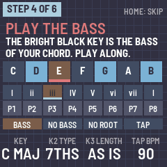
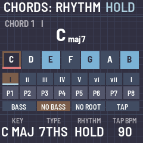
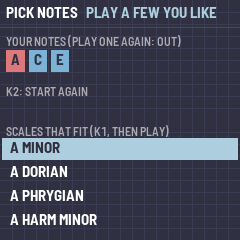
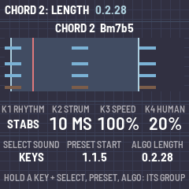
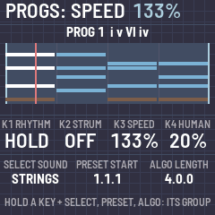
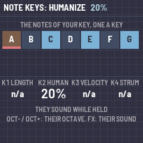

# SEED, MPS-16 ver FM1

SEED is the chord builder of MPS-16, as firmware for the M-VAVE FM-1. Play a few notes you like, pick a scale that
fits them, and the 16 white keys hold that key's chords and progressions. The black keys play the notes of the key
and light up the bass of every chord you play. It sends everything out over USB MIDI, so it can drive the synths you
already have.

This is an early test build by BeatSmith.

## Contents

1. [Install](#1-install)
2. [The first start: COACH](#2-the-first-start-coach)
3. [The keys](#3-the-keys)
4. [Home](#4-home)
5. [PICK NOTES](#5-pick-notes)
6. [LIB](#6-lib)
7. [Hold a key: SELECT, PRESET, ALGO](#7-hold-a-key-select-preset-algo)
8. [EDIT and LOCK](#8-edit-and-lock)
9. [LOOP, UNDO, SAVE and LOAD](#9-loop-undo-save-and-load)
10. [SOUND, MIDI and SETUP](#10-sound-midi-and-setup)
11. [All the controls](#11-all-the-controls)

## 1. Install

From Chrome or Edge on a computer, with the FM-1 connected by USB: open the [installer](../install/) and follow it.
The installer can put M-VAVE's own firmware back. You can also [try SEED in the browser](../emu/) first: it runs the
same code, with sound.

## 2. The first start: COACH

The first time SEED starts, it asks whether to show its steps. Turn **K1** to choose **NO, NOT NOW**, **THIS FIRST
TIME** or **EVERY START**, then press **PLAY**. You can change it later on the SYS page (K4).

COACH is six short steps. Each one says what to do, and the keys and buttons it means light up or blink. When you do
the step, it moves on by itself:

1. **PICK YOUR NOTES**: play a few notes you like, on any keys.
2. **PICK A SCALE**: turn K1 to a scale that fits, press PLAY.
3. **PLAY THE PADS**: the white keys blink. Play a few.
4. **PLAY THE BASS**: the bright black key is the bass of the chord you just played.
5. **SHAPE IT**: turn K2 for 7ths and 9ths, K3 for how the pads play.
6. **BASS OR NOT**: try one of the last four black keys.

**HOME** skips the steps. **HOME + SYS** starts them again any time.

## 3. The keys

- **CHORD KEYS**: white keys 1 to 8, your key's chords (1 to 7, then the first one an octave up).
- **PROGRESSION KEYS**: white keys 9 to 16, progressions of four bars each. A tap plays one once, holding it loops it.
  One progression plays at a time: start another and the first stops.
- **NOTE KEYS**: the first 7 black keys. The notes of your key, from the root up, sounding while you hold them.
- **C pads**: the last 4 black keys. **BASS**, **NO BASS**, **NO ROOT** and **TAP**.

The note keys' lights show the chord you played last, so you always know what to play along:

| Light | Means |
|---|---|
| Bright | the bass of the chord |
| Blinking | the bass, taken out by NO BASS or NO ROOT: still the note to play under it |
| Mid | the rest of the chord |
| Dim | the rest of the key |

The screen shows the same thing in the Earth Science colours, as MPS-16 ver WEB does: brown the bass, red the root,
blue the chord, an outline for a note that was taken out.

**BASS, NO BASS, NO ROOT**: BASS plays the chords as they are, and the progressions with a bass line. NO BASS drops
each chord's bottom note and the bass line. NO ROOT drops the root too, as long as two notes stay. Like every change,
it goes to the group you played last (all the chord keys, or all the progression keys); **hold a key** while you tap
it and it goes to that key alone.

**TAP**: tap it on the beat a few times and the BPM follows. Its light flashes on the beat. MIDI clock coming in sets
the BPM too.

## 4. Home

| Control | Does |
|---|---|
| K1 | The scale (major, minor and the modes) |
| K2 | TYPE: TRIADS, 7THS, 9THS, SUS2, SUS4, ADD9 |
| K3 | LENGTH: 1/32, 1/16, 1/8, 1/4, 1/2, AS IS, 1 BAR, 2 BARS, 4 BARS, LEGATO. The group played last, or hold a key for that key |
| K4 | Free for now |
| OCT- / OCT+ | Octave: of the key you hold, else of the group you played last |
| Hold a key + SELECT | The group's sound, or MIDI 1-4 |
| Hold a key + PRESET | The group's window START |
| Hold a key + ALGO | The group's window LENGTH |
| HOME, held | SHIFT |

## The one rule

Every change goes to the **group you played last**: all the chord keys, all the progression keys, or the note keys.
**Hold a key** while you make the change and it goes to that key alone. A group change sets every key in it to the
same value. LOCKed keys are left out of group changes.

## 5. PICK NOTES

Press **EDIT**. Every key is now a note, like a normal keyboard. Play the notes you like: each one you play is added,
and playing it again takes it out. The scales that hold all of them are listed below, best first (the first note
you played as the root). Turn **K1** to choose one and press **PLAY**: the keys are rebuilt in that key. **K2**
starts again. This is where the key's root is set now. EDIT again (or HOME) goes back without changing anything.

## 6. LIB

Press **SEL**. **K1** picks what's listed: TRIADS, 7THS, 9THS, SUS2, SUS4, ADD9 or PROGRESSIONS. Turn **K2** to
choose one, **PLAY** to hear it, and a **white key** puts it on that pad. It follows the key when you change it.

## 7. Hold a key: SELECT, PRESET, ALGO

SELECT, PRESET and ALGO do one thing each, on every screen, and only while you **hold a key**. The change goes to
that key's whole group.

| Hold a key and turn | Does |
|---|---|
| SELECT | The group's output: a sound (WARM, KEYS, ORGAN, STRINGS, PLUCK, BASS, BELL, LEAD, PAD, BRASS), or MIDI 1, 2, 3 or 4. A sound plays on the FM-1 with no MIDI; MIDI is silent on the FM-1 and goes out on that channel |
| PRESET | START: where the group's window begins, 1/32 of a beat a click (HOME held: a 16th) |
| ALGO | LENGTH: how long the window runs before it goes round again, the same steps |

The window shows while you turn and closes when you let go: the START and END lines, dark outside. Places read
BAR.BEAT.32ND. A progression skips into its bars; a chord key on a rhythm or an arp skips into its pattern. A chord
on HOLD and the note keys have no window (n/a). This is not note LENGTH (home K3), which is how long each note lasts.

Parked for now, to be placed again: the key's root (set in PICK NOTES meanwhile), INVERSION and SWING.

## 8. EDIT and LOCK

**ENV** opens EDIT for the group you played last; ENV again goes home. The title says what the knobs change: CHORD
KEYS, PROGRESSION KEYS, NOTE KEYS, or the one key you hold. The top shows the notes of the key played last, and a
playhead crosses them while it plays: a progression's four bars, or one bar of how a chord plays. Brown is the lowest
note, white the notes sounding now.

The knobs, most used first:

| Control | Chord and progression keys |
|---|---|
| K1 | RHYTHM: HOLD, STABS, OFFBEAT, 3-3-2, SYNC, ARP UP, ARP DOWN, ARP UP-DN, ARP RANDOM |
| K2 | STRUM: the chord's notes one after another, OFF to 200 ms |
| K3 | SPEED, 50% to 200% |
| K4 | HUMANIZE: each note a little off in time and velocity, like a player |

The **note keys** sound while you hold them, so only HUMANIZE (K4) applies to them; the rest shows n/a. OCT- and OCT+
move their octave, FX picks their sound.

**LFO** is **LOCK**: it locks the key you played last, so it stays exactly as it is when the key, type or bass mode
changes, and group changes leave it out. LFO again unlocks it. A small corner marks a locked key.

## 9. LOOP, UNDO, SAVE and LOAD

**REC** opens the LOOP window and arms it: REC blinks. **PLAY** gives a bar's intro (the metronome counts it in),
then the loop runs and records what goes out as MIDI: chord keys, progression keys with their rhythms, note keys and
MIDI in. Every pass that records becomes a layer, so keep playing to stack parts.

| Control | Does |
|---|---|
| PLAY | Armed: the intro, then recording. Playing: stop. Stopped: play the loop (no recording) |
| REC | Playing: recording on and off. Stopped: arm. In another screen: back to LOOP |
| ARP | The last layer off |
| HOME + REC | Clear the loop |
| K1 | METRONOME: OFF, INTRO ONLY, ALWAYS (the FM-1's speaker only, never MIDI) |
| K2 | BARS: 1, 2, 4, 8 |
| K3 | QUANTIZE: OFF or 16THS, on playback, so it can always be switched off again |
| K4 | SWING: STRAIGHT to 75%, with QUANTIZE on |

The loop plays out on the channels its notes came in on and follows TAP and MIDI clock. It keeps playing when you
leave the window; PLAY stops it anywhere. The colours: blue chord keys, light blue progression keys, red note keys,
white the keyboard and MIDI in.

**SYS** (GLO) tapped is **STOP ALL**, always dim lit: every key, the loop, all notes off on every channel. Hold SYS
for SETUP, and **HOME + SYS** for COACH.

**ARP** outside the loop window is **UNDO**: one step back (a LIB drop, clearing the keys, a LOAD). ARP again goes
forward.

**SHIFT** is **HOME held**. **SHIFT + PLAY** clears every key that isn't locked. ARP undoes it.

**SAVE** keeps the keys, their EDIT settings, the loop and the settings. **Hold SAVE** to LOAD them back.

## 10. SOUND, MIDI and SETUP

**FX** opens SOUND, the overview of every group's output: K1 the chord keys, K2 the progression keys, K3 the note
keys, K4 the keyboard (PICK NOTES and LIB). Each is either a sound on the FM-1 (no MIDI), or MIDI 1 to 4 (silent on
the FM-1). Hold a key and turn SELECT for the same anywhere.

Ten sounds: WARM, KEYS, ORGAN, STRINGS, PLUCK, BASS, BELL, LEAD, PAD, BRASS.

MIDI goes out over **USB** and **Bluetooth** (the FM-1's TRS jack is MIDI in only). MIDI coming in on channels 1 to
4 plays that group's sound; above 4, the keyboard's. **SYS** sends all notes off on every channel.

**Hold SYS** for SETUP: K1 Bluetooth MIDI on or off, K2 MIDI clock out (24 a beat, at the BPM), K3 MIDI clock in
(the BPM follows it while it comes), K4 the steps (OFF, FIRST, ALWAYS). **HOME + SYS** for the steps.

## 11. All the controls

| Control | Does |
|---|---|
| Chord keys (white 1 to 8) | Chords. In LIB, take the pick. In REC, pick the key |
| Progression keys (white 9 to 16) | Progressions, one at a time. A tap plays it once, held it loops |
| Note keys (black 1 to 7) | The notes of the key, lit by the chord you played |
| C pads (last 4 black keys) | BASS, NO BASS, NO ROOT (the group, or the key held), TAP |
| HOME | Home. Held: SHIFT. In COACH: skip |
| EDIT | PICK NOTES |
| SEL | LIB |
| ENV | EDIT: the group played last, or the key held |
| LFO | LOCK |
| FX | SOUND: every group's sound or MIDI channel |
| SYS (GLO) | STOP ALL, always dim lit. Held: SETUP. HOME + SYS: COACH |
| PLAY | The loop: armed, the intro and recording; playing, stop; stopped, play. SHIFT: clear the keys. In PICK NOTES: use the scale. In LIB: hear it |
| ARP | UNDO. In LOOP: the last layer off |
| SEQ | Free for now |
| REC | LOOP: open it armed, recording on and off. HOME + REC: clear |
| SAVE | Save. Held: LOAD |
| OCT- / OCT+ | Octave: of the key you hold, else the group played last. In PICK NOTES: the keyboard |
