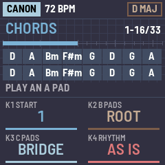
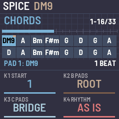
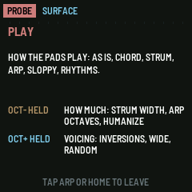
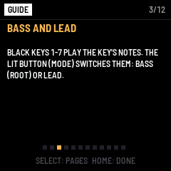
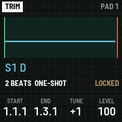
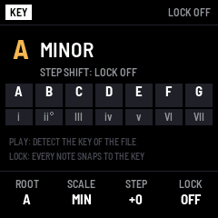
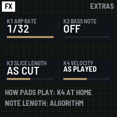
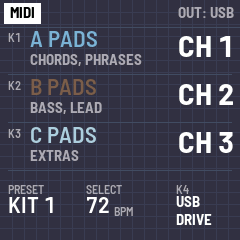

# MPS-16 ver FM1

MPS-16 ver FM1 is a MIDI phrase sampler for the M-VAVE FM-1 by BeatSmith. Load a MIDI file and it's on 16 pads at
once, cut into slices, in its own key: play its chords and phrases, play bass and lead over them, change key for a
bridge, and send it all out as MIDI.

## Contents

1. Install
2. The pads: A, B and C
3. Home
4. SPICE and UNDO
5. The B and C pads
6. Help: ANALYZE and GUIDE
7. The tools: SLICE, TRIM, LIB, KEY, FX
8. MIDI, kits and the USB drive
9. All the controls
10. Troubleshooting

---

## 1. Install

To try it first, open the emulator in a browser. It runs the same code, with sound.

To install it, use Chrome or Edge on a computer. Connect the FM-1 by USB, open the installer and press Install. Allow
MIDI when the browser asks. Don't unplug the cable while it writes. From a terminal:
`python3 tools/fm1_install.py mps-16-VERSION.fwsc`.

To go back to the stock firmware, use the installer's last section with M-VAVE's own firmware file. On its first
start MPS-16 ver FM1 sets up its drive in the FM-1's spare flash.

## 2. The pads: A, B and C

The FM-1's keys have names in MPS-16:

- **A pads**: the 16 white keys. The song's slices, chords and phrases.
- **B pads**: the first 7 black keys. The notes of your key: bass, lead, 3rds or 5ths.
- **C pads**: the last 4 black keys (C1 to C4). Key changes for a bridge, or extra chords and notes.

## 3. Home

There's **one home screen**, and **HOME** always brings you back to it. Load a MIDI file and it's already on the 16 A
pads, in the file's key: no slicing to do.

| Control | Turn it to choose |
|---|---|
| PRESET | CHOP, how the song is chopped into slices: TRANSIENT (each new hit), BEATS, BARS, CHORDS (each chord change, its name on the pad) |
| K1 START | Where in the song the 16 pads start: one slice a click |
| K2 B PADS | What the B pads play: ROOT (bass), LEAD, 3RD or 5TH |
| K3 C PADS | What the C pads do: BRIDGE (key changes), SUGGEST (4 chords that tend to follow the pad you played), OUTSIDE (4 notes off the scale, the bluest first), BORROW (4 chords from the parallel key) |
| K4 RHYTHM | How the pads play: AS IS (the slice as recorded), CHORD (the slice as one held chord), or rhythms: STABS, OFFBT, 3-3-2, SYNC. Strum, humanize, arp and voicing are on FX |
| SELECT | BPM, the tempo (shown at the top, with the octave when it isn't 0) |
| ALGORITHM | The notes' length: left shorter (down to 10%, tight stabs), the middle as played, right longer (up to 450%, then LEGATO) |

**Second jobs** (hold an OCT button and turn ALGORITHM): **OCT-**: the slices' length. **OCT+**: the velocity curve.
OCT- and OCT+ move the octave only when you let go, so holding one for a second job never moves it.

The screen shows how the song is cut and which slices are on the pads, the song as a ruler with that stretch marked,
the 16 A pads with their chord names, the pad played last, and the four knobs.

**Your pads**: a pad you trim, or drop a slice or a LIB chord on, is **locked**: it stays yours while the rest follow
the song (when you turn PRESET or K1, or load a file). A small corner marks it. TRIM's PRESET frees it again.

## 4. SPICE and UNDO

**SPICE (MODE)**: play an A pad, then press **MODE**. Each press gives that pad its next color: 7, 9, 11, 13, then sus4,
sus2, add9, 6, then plain again. The pad shows the new name and locks.

**UNDO (ARP)**: takes back the last drop (a slice or a LIB chord), trim or SPICE. Press it again to put it back (a
redo). The FM-1 keeps one step.

## 5. The B and C pads

**B pads** (K2):

- **ROOT**: each plays a bass note under the pads. When a pad plays, the B pad of its chord's root lights up.
- **LEAD**: each plays a lead note over the pads. While a phrase plays, the B pads follow its melody: the note now is
  lit full, the next one breathes. Play along.
- **3RD**, **5TH**: each note with its 3rd or 5th in the key.

**C pads with BRIDGE** (K3): key changes, always from your home key.

| Pad | Goes to | From D major |
|---|---|---|
| C1 | Home: your key | D major |
| C2 | Up a 4th, the usual bridge | G major |
| C3 | The parallel key: same root, major and minor swapped | D minor |
| C4 | Up a step, the last-chorus lift | E major |

**Tap** one to go there: the **whole song moves**, the pads, the bass and the lead, each note degree for degree (on C3
a D chord becomes Dm and a Bm becomes Bb), and the pads show the new names. The C pad in use is lit, C1 when you're
home. **Tap C1** to come home. **Hold** one for a look first: the pads whose chords lead into it smoothly light up.

## 6. Help: ANALYZE and GUIDE

**ANALYZE**: tap **OCT- and OCT+ together**. Now touch anything, a pad, a knob or a button: nothing plays or changes,
and the screen says what it is right now and what it does ("A PAD 6: DM7", "B PAD 1: D, plays D as bass", "C3
PARALLEL: song and keys to D minor"). Tap OCT- and OCT+ together again, or HOME, to leave.

**GUIDE**: short pages, from playing pads to MIDI out. It opens by itself the first time; **hold SYS** for it any
time. Turn SELECT for the next page; the buttons and pads a page talks about blink. HOME leaves.

## 7. The tools: SLICE, TRIM, LIB, KEY, FX

Each tool opens from home with its button, and **HOME** brings you back.

**SLICE (SEL)**: the song as a waveform with its slices. SELECT picks a slice and plays it; K1 CHOP (the same as
PRESET at home); K2, with TRANSIENT, how sure a hit must be; K3 and K4 move the slice's start and end by 16ths. **An A pad
takes it** (and locks). SEL again opens **FILES**: SELECT picks the file, K1 a track, K2 turns it on or off.

**TRIM (ENV)**: the A pad played last; an A pad there picks another. K1 START and K2 END (a phrase, by 16ths), K3
TUNE, K4 LEVEL, SELECT ONE-SHOT, GATE or LOOP. **PRESET: LOCKED or FOLLOWS SONG.** Trimming locks it. Nothing is cut
away: you can always widen it again.

**LIB (LFO)**: the chords and progressions of your key. K1 the chord type, K2 the progressions' rhythm, K3 chords or
progressions, SELECT picks one and plays it, **an A pad takes it**. K4 builds a whole kit at once.

**KEY (EDIT)**: K1 the root, K2 the scale, K3 the step shift, K4 the scale lock (every note snaps into the key; the
step shift then moves every note by scale steps). PLAY finds the loaded file's key. **FIND: tap a few pads** on KEY:
it lists every key that has all those notes, best first; SELECT picks one, K4 uses it and opens LIB. K1 takes back the
last note, K2 clears them.

**FX**: two pages; FX again flips. **MIDI FX** first: K1 STRUM (up to 200 ms), K2 HUMANIZE (timing and velocity),
K3 ARP (OFF, UP, DOWN, UP-DN, RAND), K4 VOICING (ROOT POS, INV 1 to 3, WIDE, RANDOM). **The extras** second: K1 the
arp's rate, K2 a bass note under every chord, K3 the slice length (each slice x1/4 to x4 from its start), K4 the
velocity curve (softer or harder), SELECT the arp's octaves (1 to 3).

## 8. MIDI, kits and the USB drive

**Tap SYS** for the MIDI page:

- **K1, K2, K3**: the A, B and C pads' MIDI channels (1 to 16; at first 1, 2, 3). Every note goes out over USB on its
  group's channel, so your DAW or synths can give each group its own sound: your sample or keys on the A pads, your
  bass on the B pads. The FM-1's TRS jack is MIDI in only.
- **PRESET**: the kit, 1 to 8. A kit keeps your locked pads; the rest follow the song.
- **SELECT**: the tempo.
- **K4 right**: the **USB drive**. The FM-1 shows the computer a drive called MPS-16 (about 270 KB): copy `.mid`
  files on, then eject. No USB MIDI meanwhile; HOME leaves drive mode.

**SAVE** keeps the settings and the kit (KIT01.CSK to KIT08.CSK on the drive). **REC** records MIDI coming in (USB or
the TRS jack); REC again saves it as RECnn.MID and opens it. MIDI in also plays the built-in synth, a simple twelve-voice
sound for now. MASTER is the volume.

## 9. All the controls

| Control | Does |
| --- | --- |
| A pads (white keys) | The song's slices and chords. In SLICE or LIB, take the pick |
| B pads (black keys 1-7) | Bass, lead, 3rds or 5ths in the key (K2) |
| C pads (last 4 black keys) | With BRIDGE: C2-C4 key changes, C1 home; or SUGGEST, OUTSIDE, BORROW (K3) |
| HOME | Home, from anywhere |
| SEL, ENV, LFO, EDIT, FX | The tools: SLICE, TRIM, LIB, KEY, FX |
| GLO (SYS) | The MIDI page (channels, kit, tempo, USB drive). Held: GUIDE |
| OCT- / OCT+ | The octave, when you let go. Held with a knob: its second job. Both tapped: ANALYZE |
| PRESET | Home: CHOP. TRIM: lock. MIDI page: the kit |
| ALGORITHM | The notes' length |
| SELECT | Home: BPM. In the tools: pick |
| K1 to K4 | What the screen says |
| SAVE | Keep the settings and the kit |
| PLAY | All notes off. In SLICE or LIB, hear the pick. In KEY, find the file's key |
| REC | Record MIDI coming in; again to stop and save it |
| ARP | UNDO (again: redo) |
| SEQ (MODE) | SPICE the A pad played last |

## 10. Troubleshooting

If the installer doesn't find the FM-1, use Chrome or Edge, allow MIDI, and close other programs that use its MIDI
port. If the FM-1 doesn't start after an install, it starts in SAFE MODE after two failed starts; USB still works,
so the installer can reach it to install again or put the stock firmware back.

If a file doesn't show in FILES, it isn't a standard MIDI file, or it's too big (96 KB at most).
