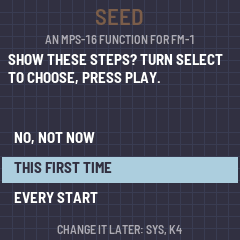
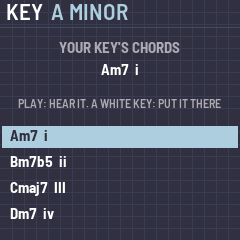
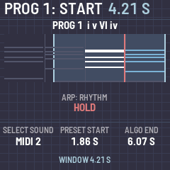
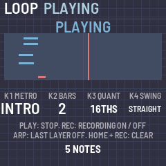
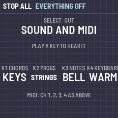
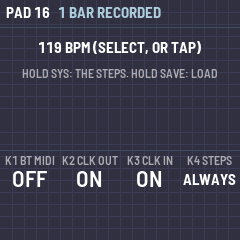

# SEED, MPS-16 ver FM1

SEED is the chord builder of MPS-16, as firmware for the M-VAVE FM-1. Play a few notes you like, pick a scale that
fits them, and the 16 white keys hold that key's chords and progressions. The black keys play the notes of the key
and light up the bass of every chord you play. It sends everything out over USB MIDI, so it can drive the synths you
already have.

This is an early test build by BeatSmith.

## Contents

1. [Install](#1-install)
2. [The first start: COACH](#2-the-first-start-coach)
3. [The keys](#3-the-keys)
4. [Home](#4-home)
5. [SEQ: your notes, the key, the type](#5-seq-your-notes-the-key-the-type)
6. [LIB](#6-lib)
7. [Hold a key: SELECT, PRESET, ALGO](#7-hold-a-key-select-preset-algo)
8. [EDIT, ARP, ENV, LFO and LOCK](#8-edit-arp-env-lfo-and-lock)
9. [LOOP, UNDO, SAVE and LOAD](#9-loop-undo-save-and-load)
10. [SOUND, MIDI and SETUP](#10-sound-midi-and-setup)
11. [All the controls](#11-all-the-controls)

## 1. Install

From Chrome or Edge on a computer, with the FM-1 connected by USB: open the [installer](../install/) and follow it.
The installer can put M-VAVE's own firmware back. You can also [try SEED in the browser](../emu/) first: it runs the
same code, with sound.

## 2. The first start: COACH

The first time SEED starts, it asks whether to show its steps. Turn **K1** to choose **NO, NOT NOW**, **THIS FIRST
TIME** or **EVERY START**, then press **PLAY**. You can change it later in SETUP (hold FX, K4).

COACH is six short steps. Each one says what to do, and the keys and buttons it means light up or blink. When you do
the step, it moves on by itself:

1. **PICK YOUR NOTES**: play a few notes you like, on any keys.
2. **PICK A SCALE**: turn K1 to a scale that fits, press PLAY.
3. **PLAY THE PADS**: the white keys blink. Play a few.
4. **PLAY THE BASS**: the bright black key is the bass of the chord you just played.
5. **SHAPE IT**: tap ARP a few times to change how the chords play.
6. **BASS OR NOT**: try one of the last four black keys.

**HOME** skips the steps. **HOME + FX** starts them again any time.

## 3. The keys

- **CHORD KEYS**: white keys 1 to 8, your key's chords (1 to 7, then the first one an octave up).
- **PROGRESSION KEYS**: white keys 9 to 16, progressions of four bars each. A tap plays it once, START to END, even if you let go; tapping again restarts it. GLO stops it. The LOOP recorder does the looping.
  One progression plays at a time: start another and the first stops.
- **NOTE KEYS**: the first 7 black keys. The notes of your key, from the root up, sounding while you hold them.
- **C pads**: the last 4 black keys. **BASS**, **NO BASS**, **NO ROOT** and **TAP**.

The note keys' lights show the chord you played last, so you always know what to play along:

| Light | Means |
|---|---|
| Bright | the bass of the chord |
| Blinking | the bass, taken out by NO BASS or NO ROOT: still the note to play under it |
| Mid | the rest of the chord |
| Dim | the rest of the key |

The screen shows the same thing in the Earth Science colours, as MPS-16 ver WEB does: brown the bass, red the root,
blue the chord, an outline for a note that was taken out.

**BASS, NO BASS, NO ROOT**: BASS plays the chords as they are, and the progressions with a bass line. NO BASS drops
each chord's bottom note and the bass line. NO ROOT drops the root too, as long as two notes stay. Like every change,
it goes to the group you played last (all the chord keys, or all the progression keys); **hold a key** while you tap
it and it goes to that key alone.

**TAP**: tap it on the beat a few times and the BPM follows. Its light flashes on the beat. MIDI clock coming in sets
the BPM too.

## 4. Home

The buttons are named for what they do:

| Button | Does |
|---|---|
| HOME | Home. Held: SHIFT |
| EDIT | Pad edit: the window, START and END, with the notes and playhead. SHIFT + EDIT: LOCK |
| SEQ | What the keys hold: your notes, the scale, the root, the chord type |
| SEL | LIB: chords and progressions to put on keys |
| ARP | The RHYTHM of the group played last, one step a tap. SHIFT + ARP: UNDO |
| ENV | The notes' shape: LENGTH, HUMANIZE, VELOCITY, STRUM |
| LFO | The groove: SWING, SPEED, INVERSION |
| FX | SOUND. Held: SETUP. SHIFT + FX: COACH |
| SAVE | Save. Held: LOAD |
| PLAY, REC | The looper |
| GLO | STOP ALL |
| OCT- / OCT+ | Octave: of the key you hold, else of the group you played last |

The knobs at home are free for now. Hold a key with SELECT, PRESET or ALGO anywhere for its group's sound, START and
END (section 7).

## The one rule

Every change goes to the **group you played last**: all the chord keys, all the progression keys, or the note keys.
**Hold a key** while you make the change and it goes to that key alone. A group change sets every key in it to the
same value. LOCKed keys are left out of group changes.

## 5. SEQ: your notes, the key, the type

Press **SEQ**. Every key is now a note, like a normal keyboard. Play the notes you like: each one you play is added,
and playing it again takes it out. The scales that hold all of them are listed below, best first (the first note
you played as the root). Turn **K1** to choose one and press **PLAY**: the keys are rebuilt in that key.

| Knob | Does |
|---|---|
| K1 | The scale: of those that fit your notes, or with no notes, every scale |
| K2 | Start again |
| K3 | The key's root |
| K4 | TYPE: TRIADS, 7THS, 9THS, SUS2, SUS4, ADD9 |

SEQ again (or HOME) goes back.

## 6. LIB

Press **SEL**. **K1** picks what's listed: TRIADS, 7THS, 9THS, SUS2, SUS4, ADD9 or PROGRESSIONS. Turn **K2** to
choose one, **PLAY** to hear it, and a **white key** puts it on that pad. It follows the key when you change it.

## 7. Hold a key: SELECT, PRESET, ALGO

SELECT, PRESET and ALGO do one thing each, on every screen, and only while you **hold a key**. The change goes to
that key's whole group.

| Hold a key and turn | Does |
|---|---|
| SELECT | The group's output: a sound (WARM, KEYS, ORGAN, STRINGS, PLUCK, BASS, BELL, LEAD, PAD, BRASS), or MIDI 1, 2, 3 or 4. A sound plays on the FM-1 with no MIDI; MIDI is silent on the FM-1 and goes out on that channel |
| PRESET | START: the line where the window begins |
| ALGO | END: the line where it ends |

The lines move smoothly, in tiny steps that grow the faster you turn (hold HOME for the finest). They go anywhere,
notes there or not, up to a quarter of the sequence past either edge, and the notes never move: what's outside the
lines is dark and doesn't play. The window shows while you turn and closes when you let go, with its length in
seconds.

- **Progression keys**: a tap plays START to END once.
- **Chord keys on a rhythm or an arp**: START to END goes round while you hold the key, and stops when you let go.
- **Chord keys on HOLD (plain or strummed)**: sound until you let go. START before the chord gives a gap before it
  sounds; END doesn't apply.
- **Note keys**: a piano, no window.

This is not note LENGTH (ENV K1), which is how long each note lasts.

Parked for now, to be placed again: the key's root (set in PICK NOTES meanwhile), INVERSION and SWING.

## 8. EDIT, ARP, ENV, LFO and LOCK

These shape how the keys play. Each change goes to the group played last, all set to the same value; hold a key
while you turn a K knob and it goes to that key alone. The top of EDIT, ENV and LFO shows the notes of the key played
last with the playhead, brown the lowest note, white the notes sounding now. Press the same button again for home.

**ARP** steps the RHYTHM, no screen: HOLD, STABS, OFFBEAT, 3-3-2, SYNC, ARP UP, ARP DOWN, ARP UP-DN, ARP RANDOM.

**EDIT** is pad edit, the window: turn PRESET for START and ALGO for END here without holding a key (section 7).

**ENV**, the notes' shape:

| Knob | Does |
|---|---|
| K1 | LENGTH: 1/32, 1/16, 1/8, 1/4, 1/2, AS IS, 1 BAR, 2 BARS, 4 BARS, LEGATO |
| K2 | HUMANIZE: each note a little off in time and velocity, like a player |
| K3 | VELOCITY: as you play it, or a fixed one |
| K4 | STRUM: the chord's notes one after another, OFF to 200 ms |

**LFO**, the groove:

| Knob | Does |
|---|---|
| K1 | SWING: the off-beats late, STRAIGHT to 75% |
| K2 | SPEED, 50% to 200% |
| K3 | INVERSION, -3 to +3 (chord keys) |

The **note keys** sound while you hold them, so only HUMANIZE (ENV K2) applies to them.

**SHIFT + EDIT** is **LOCK**: it locks the key you played last, so it stays exactly as it is when the key, type or
bass mode changes, and group changes leave it out. Again unlocks it. A small corner marks a locked key.

## 9. LOOP, UNDO, SAVE and LOAD

**REC** opens the LOOP window and arms it: REC blinks. **PLAY** gives a bar's intro (the metronome counts it in),
then the loop runs and records what goes out as MIDI: chord keys, progression keys with their rhythms, note keys and
MIDI in. Every pass that records becomes a layer, so keep playing to stack parts.

| Control | Does |
|---|---|
| PLAY | Armed: the intro, then recording. Playing: stop. Stopped: play the loop (no recording) |
| REC | Playing: recording on and off. Stopped: arm. In another screen: back to LOOP |
| SHIFT + ARP | The last layer off |
| HOME + REC | Clear the loop |
| K1 | METRONOME: OFF, INTRO ONLY, ALWAYS (the FM-1's speaker only, never MIDI) |
| K2 | BARS: 1, 2, 4, 8 |
| K3 | QUANTIZE: OFF or 16THS, on playback, so it can always be switched off again |
| K4 | SWING: STRAIGHT to 75%, with QUANTIZE on |

The loop plays out on the channels its notes came in on and follows TAP and MIDI clock. It keeps playing when you
leave the window; PLAY stops it anywhere. The colours: blue chord keys, light blue progression keys, red note keys,
white the keyboard and MIDI in.

**GLO** is **STOP ALL**, always dim lit: every key, the loop, all notes off on every channel.

**SHIFT + ARP** outside the loop window is **UNDO**: one step back (a LIB drop, clearing the keys, a LOAD).
Again goes forward.

**SHIFT** is **HOME held**. **SHIFT + PLAY** clears every key that isn't locked. ARP undoes it.

**SAVE** keeps the keys, their EDIT settings, the loop and the settings. **Hold SAVE** to LOAD them back.

## 10. SOUND, MIDI and SETUP

**FX** opens SOUND, the overview of every group's output: K1 the chord keys, K2 the progression keys, K3 the note
keys, K4 the keyboard (PICK NOTES and LIB). Each is either a sound on the FM-1 (no MIDI), or MIDI 1 to 4 (silent on
the FM-1). Hold a key and turn SELECT for the same anywhere.

Ten sounds: WARM, KEYS, ORGAN, STRINGS, PLUCK, BASS, BELL, LEAD, PAD, BRASS.

MIDI goes out over **USB** and **Bluetooth** (the FM-1's TRS jack is MIDI in only). MIDI coming in on channels 1 to
4 plays that group's sound; above 4, the keyboard's. **GLO** sends all notes off on every channel.

**Hold FX** for SETUP: K1 Bluetooth MIDI on or off, K2 MIDI clock out (24 a beat, at the BPM), K3 MIDI clock in
(the BPM follows it while it comes), K4 the steps (OFF, FIRST, ALWAYS). **HOME + FX** for the steps.

## 11. All the controls

| Control | Does |
|---|---|
| Chord keys (white 1 to 8) | Chords. In LIB, take the pick. In REC, pick the key |
| Progression keys (white 9 to 16) | Progressions, one at a time. A tap plays START to END once |
| Note keys (black 1 to 7) | The notes of the key, lit by the chord you played |
| C pads (last 4 black keys) | BASS, NO BASS, NO ROOT (the group, or the key held), TAP |
| HOME | Home. Held: SHIFT. In COACH: skip |
| EDIT | Pad edit: the window, PRESET START, ALGO END. HOME + EDIT: LOCK |
| SEL | LIB |
| ENV | The notes' shape: LENGTH, HUMANIZE, VELOCITY, STRUM |
| LFO | The groove: SWING, SPEED, INVERSION |
| FX | SOUND: every group's sound or MIDI channel. Held: SETUP. HOME + FX: COACH |
| GLO | STOP ALL, always dim lit |
| PLAY | The loop: armed, the intro and recording; playing, stop; stopped, play. SHIFT: clear the keys. In SEQ: use the scale. In LIB: hear it |
| ARP | RHYTHM, a step a tap. HOME + ARP: UNDO (in LOOP: the last layer off) |
| SEQ | Your notes, the scale (K1), the root (K3), the chord type (K4) |
| REC | LOOP: open it armed, recording on and off. HOME + REC: clear |
| SAVE | Save. Held: LOAD |
| OCT- / OCT+ | Octave: of the key you hold, else the group played last. In SEQ: the keyboard |
